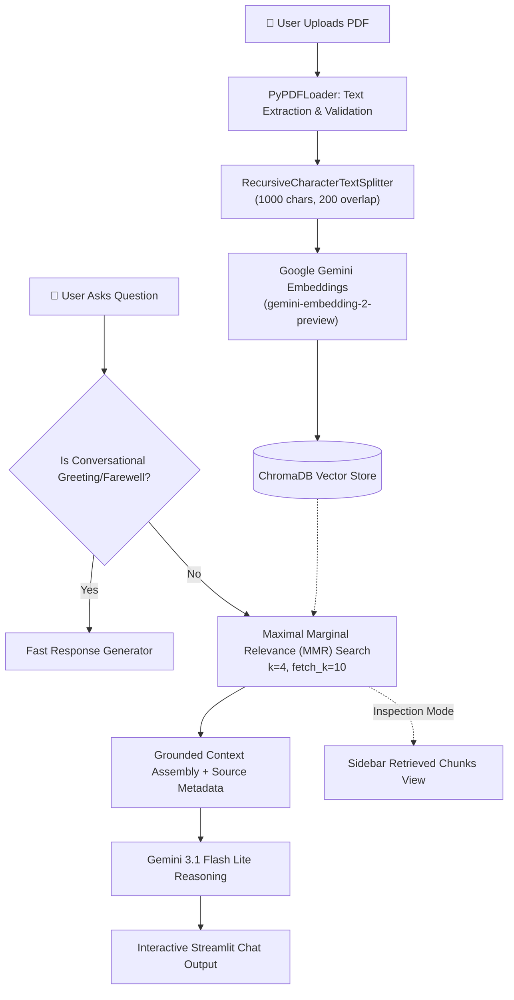

# ⚡ Fieldwise-AI

<p align="center">
  
  
  
  
  
  
  
</p>

---

## 📌 Overview

**Fieldwise-AI** is a high-performance, intelligent Retrieval-Augmented Generation (RAG) system created and developed by **Lakshay Deol**. It transforms complex, lengthy, and unstructured PDF documents into an interactive, conversational knowledge base.

Powered by **Google Gemini 3.1 Flash Lite**, **Google Generative AI Embeddings**, **LangChain**, and **ChromaDB**, Fieldwise-AI enables users to upload document files and receive instant, verifiable, and deeply contextual answers with strict hallucination controls and page-level source attribution.

---

## 🚀 Key Features

- **📑 Smart PDF Ingestion & Validation**  
  Extracts document text page-by-page using `PyPDFLoader`. Automatically validates documents to detect scanned, empty, or unreadable PDFs and guides the user accordingly.

- **✂️ Context-Preserving Adaptive Chunking**  
  Employs `RecursiveCharacterTextSplitter` configured with a 1,000-character window and 200-character overlap, guaranteeing semantic continuity across chunk boundaries without losing context.

- **🧠 Google Gemini Generative & Embedding Models**  
  Uses Google's `gemini-embedding-2-preview` for high-dimensional semantic vector representations and `gemini-3.1-flash-lite` for ultra-fast, zero-temperature reasoning.

- **🎯 Maximal Marginal Relevance (MMR) Retrieval**  
  Retrieval is driven by ChromaDB using an MMR ranking strategy (`k=4`, `fetch_k=10`). MMR balances relevance with information diversity, preventing redundant chunks and ensuring broad context coverage.

- **🛡️ Strict Zero-Hallucination Prompt Engineering**  
  Equipped with robust prompt instructions that restrict the model to provide answers strictly grounded in the document context. If information is absent or partial, Fieldwise-AI explicitly highlights what is missing rather than guessing.

- **🔍 Full Explainability & Chunk Inspection**  
  An interactive sidebar toggle gives complete transparency into the system's inner workings by showing the exact retrieved chunks, similarity ranks, and source page numbers for any generated response.

- **💬 Conversational Bypass & Speed Optimization**  
  Filters greetings, pleasantries, and conversational closures with lightweight heuristics to reduce unnecessary vector lookups and API calls.

- **📊 Live Document Diagnostics**  
  Sidebar telemetry provides immediate real-time statistics including total page count, generated chunk volume, active embedding model, and vector store health.

---

## 🏗️ System Architecture



---

## 🛠️ Technology Stack

| Layer | Technology | Description |
|---|---|---|
| **Frontend & UI** | [Streamlit](https://streamlit.io/) | Responsive, real-time conversational chat interface |
| **LLM Reasoning** | [Google Gemini 3.1 Flash Lite](https://ai.google.dev/) | High-speed, accurate generative reasoning (`temperature=0`) |
| **Embeddings** | [Google Generative AI Embeddings](https://ai.google.dev/) | `gemini-embedding-2-preview` semantic vector embeddings |
| **Vector Database** | [ChromaDB](https://www.trychroma.com/) | In-memory high-dimensional vector search with MMR |
| **RAG Orchestration** | [LangChain](https://www.langchain.com/) | Document loaders, text splitters, and vector store wrappers |
| **Document Parsing** | PyPDFLoader (`pypdf`) | Robust PDF text extraction and page metadata indexing |
| **Configuration** | `python-dotenv` | Secure API key and environment management |

---

## 📥 Installation & Setup

### 1. Prerequisites
- Python **3.10** or higher
- A Google AI Studio API key ([Get one here](https://aistudio.google.com/))

### 2. Clone the Repository
```bash
git clone https://github.com/Lakshay-Deol/Fieldwise-AI.git
cd Fieldwise-AI
```

### 3. Create a Virtual Environment
```bash
# Linux/macOS
python3 -m venv venv
source venv/bin/activate

# Windows
python -m venv venv
venv\Scripts\activate
```

### 4. Install Dependencies
```bash
pip install -r requirements.txt
```

### 5. Set Up Environment Variables
Create a `.env` file in the root directory by copying `.env.example`:
```bash
cp .env.example .env
```
Open `.env` and add your Google Gemini API key:
```env
GOOGLE_API_KEY=your_actual_google_gemini_api_key
```

### 6. Run the Application
```bash
streamlit run app.py
```
Fieldwise-AI will start and open automatically in your browser at `http://localhost:8501`.

---

## 💡 How to Use Fieldwise-AI

1. **Upload Document**: Drag and drop or browse to select your PDF document.
2. **Process Document**: Fieldwise-AI automatically processes the document, generates embeddings, and indexes them in ChromaDB.
3. **Ask Questions**: Type any natural-language query in the chat input.
4. **Inspect Sources**: Check the "Show Retrieved Chunks" option in the sidebar to view source text chunks alongside their respective page numbers.
5. **Manage Sessions**: Use the sidebar to clear chat history or upload a new document whenever needed.

---

## 📂 Project Structure

```text
Fieldwise-AI/
├── app.py              # Main Streamlit application and RAG pipeline
├── requirements.txt    # Project dependencies and versions
├── .env.example        # Environment variable template
├── .gitignore          # Git exclusion rules
└── README.md           # Project documentation and guide
```

---

## 👨‍💻 Author

**Lakshay Deol**  
- GitHub: [@Lakshay-Deol](https://github.com/Lakshay-Deol)  
- Repository: [Fieldwise-AI](https://github.com/Lakshay-Deol/Fieldwise-AI)

---

## 📄 License

This project is licensed under the [MIT License](LICENSE).
